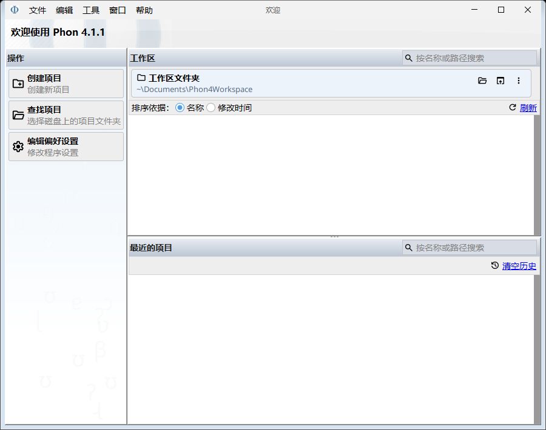
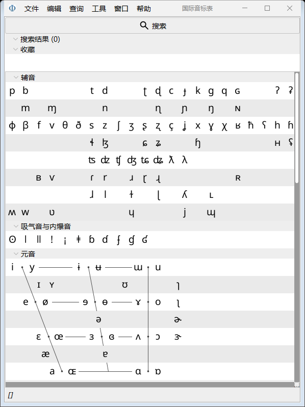

# Phon 简体中文显示补丁

为 **Windows 版 Phon 4.1.1** 提供简体中文显示，词典包含 **1,806 个英文词条**

[下载汉化包](https://github.com/f246813/phon-zh-cn/releases/latest) · [布局检查](docs/LAYOUT.md) · [验证范围](docs/VERIFICATION.md)

这是非官方补丁，需要先安装 Phon；本仓库和发布包不包含 Phon 本体

> **当前版本会改变部分界面的尺寸分配**：欢迎页左栏实测由 267 px 缩为 202 px，偏好设置窗口由 1123×1100 缩为 633×1100；原因是译文和中文字体参与原有布局的尺寸计算。该行为尚未修复，v0.1.0 不承诺保留原版几何尺寸

## 安装

1. 完全退出 Phon
2. 从 [Releases](https://github.com/f246813/phon-zh-cn/releases/latest) 下载并解压 `phon-zh-cn-0.1.0-phon4.1.1-windows.zip`
3. 双击 `install.cmd`
4. 从桌面或开始菜单中的 **Phon（简体中文）** 打开

默认查找 `C:\Program Files\Phon`，无需管理员权限；模块安装到当前用户的 `%LOCALAPPDATA%\Phon\localization-zh-CN`

Phon 安装在其他位置时，在解压目录的 PowerShell 中运行：

```powershell
.\Install-PhonChinese.ps1 -InstallDir 'D:\Applications\Phon'
```

安装器会核对目标版本为 4.1.1，不覆盖原程序的 EXE、JAR 或 `Phon.vmoptions`

## 恢复英文

退出 Phon 后双击 `restore-english.cmd`，再从原版 Phon 入口打开

也可以运行：

```powershell
.\Install-PhonChinese.ps1 -English
```

该操作只移除本包创建的中文快捷方式，保留模块文件供再次启用；原版安装和研究文件不受影响

## 覆盖范围

欢迎页、菜单、偏好设置、会话编辑器控件、国际音标表、常用查询和报告操作、媒体与声学设置、原生文件对话框的标题和常用提示

可编辑转写中的 CHAT 字段名、IPA 符号、脚本代码、表格研究数据、项目名和文件路径保留原文；在线手册及未收录的扩展插件提示仍显示英文

词典位于 `resources/zh_CN.tsv`，采用 UTF-8 编码，每行依次为英文、制表符和中文；修改已安装模块的词典后，需要完全退出并重新打开 Phon

## 实际界面

下图为真实 Phon 窗口的内部绘制结果





独立控件测试的图片与结果放在验证记录中，不作为 Phon 实际布局不变的证据

## 术语依据

声学术语对照本地 AIPraat 术语表 `tools/praat_glossary.md`，音素与音位的区分另参照 [联合国多语种术语表](https://unstats.un.org/unsd/geoinfo/ungegn/docs/pdf/Glossary_of_terms_revised.pdf)

| 英文 | 中文 |
| --- | --- |
| phone / phoneme | 音素／音位 |
| syllable / syllabification | 音节／音节划分 |
| IPA Target / IPA Actual | 目标音标／实际音标 |
| phone alignment | 音素对齐 |
| Orthography | 正字法 |
| Spectrogram / Spectrum | 声谱图／频谱 |
| Pitch / Fundamental frequency | 音高／基频 |
| Intensity / Formant | 音强／共振峰 |

参考资料还包括 [Scribd《语言学术语英汉对照》](https://www.scribd.com/document/320119134/语言学术语英汉对照)；其公开可读文本仅显示英文索引，未能读取中文译名，因此没有将它标为已逐项核对的中文来源

## 从源码构建

需要 Python 3.10+、Phon 4.1.1，以及支持 Java 21 的 JDK 编译器

```powershell
python tools/build.py --phon-dir 'C:\Program Files\Phon' --test
```

若只有 Phon 自带的 JRE，可显式指定支持 Java 21 的 Eclipse ECJ 编译器：

```powershell
python tools/build.py --phon-dir 'C:\Program Files\Phon' --ecj 'D:\Tools\ecj.jar' --test
```

脚本只使用 Python 标准库，不自动下载依赖；`build/` 保存中间文件和测试结果，`dist/` 输出汉化 ZIP 与 SHA-256 校验值

本机已验证的组合为 Phon 4.1.1 自带 Java 25、Groovy 4.0.30、ECJ 3.43.0，编译目标 Java 21

## 实现与许可

补丁通过 install4j 的 `-J-javaagent` 启动参数加载，在 Swing 显示和尺寸计算时提供译文，并对中文控件选择微软雅黑 UI 字体；原生对话框接入开源 native-dialogs 显示接口

本仓库新增源码和词典采用 [MIT 许可](LICENSE)，打包的 ASM 及 Groovy 许可信息见 [第三方说明](THIRD_PARTY_NOTICES.md)；这些许可不覆盖 Phon 本体

接口核对参考 [Phon 3 开源仓库](https://github.com/phon-ca/phon)、[native-dialogs](https://github.com/ghedlund/nativedialogs) 和 [install4j 官方 VM 参数文档](https://www.ej-technologies.com/resources/install4j/help/doc/concepts/vmParameters.html)
