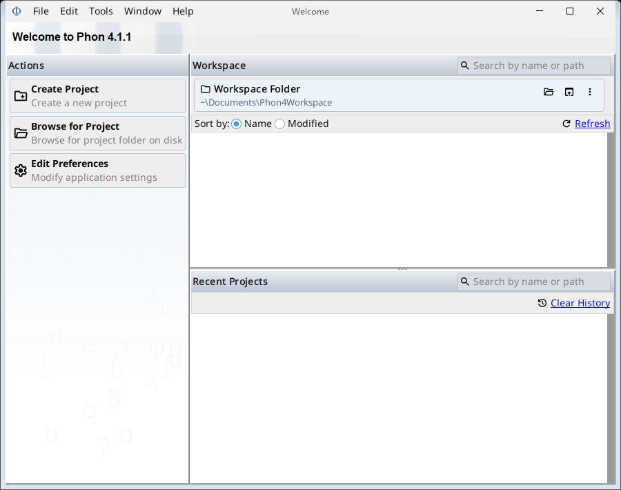

# 布局检查

**v0.1.0 保留了已确认的尺寸重排行为，本次公开打包没有修改汉化运行逻辑**

补丁为中文控件选择微软雅黑 UI 字体，同时让译文参与 `getPreferredSize` 与 `getMinimumSize` 的计算；原有布局管理器据此重新分配区域，因此不能称为“布局完全不变”

## 实测差异

| 检查项 | 英文原版 | 加载汉化补丁 |
| --- | --- | --- |
| 欢迎页窗口 | 900×710 | 900×710 |
| 欢迎页左栏宽度 | 267 px | 202 px |
| 欢迎页右侧区域起点 | x=267 | x=202 |
| 偏好设置窗口 | 1123×1100 | 633×1100 |

欢迎页的 100 个组件一一对应，组件类型、布局管理器、alignmentX 和水平文字对齐属性没有差异；66 个组件的 bounds、21 个组件的有效字体发生变化，另有两个组件的 alignmentY 因字体基线计算发生变化

偏好设置的 482 个组件也一一对应，组件类型、布局管理器和对齐属性没有差异；387 个组件的 bounds、130 个组件的有效字体发生变化

bounds 差异包含父子容器的联动变化，不能解释为同等数量的独立布局修改

## 真实窗口

英文欢迎页：

汉化欢迎页：

[英文偏好设置](images/preferences-en.png) · [汉化偏好设置](images/preferences-zh.png)

## 检查方法与边界

使用同一套 Phon 4.1.1 程序类、相同缩放和用户偏好，分别运行英文版本与加载补丁的中文版本，读取真实窗口的组件树、对齐属性、字体和几何尺寸，并调用窗口自身的绘制接口保存图像

测试入口中的汉化欢迎页还与已安装程序交叉比较，100 个组件的几何、字体和对齐属性一致；直接调用原程序入口时，两组出现相同的 install4j 更新配置文件缺失日志

本次范围为欢迎页与偏好设置，图像是实际窗口内部绘制结果；没有据此证明所有编辑器、插件、多显示器或缩放环境都没有布局问题

原始差异见 [layout-comparison.json](verification/layout-comparison.json)

## 居中测试图的澄清

曾展示的纵向居中文字图片来自独立的 `DisplayTest.java` 控件测试窗口，其 `BoxLayout` 按默认 alignmentX 居中排列标签，不是 Phon 的真实窗口；该测试程序没有被安装到 Phon

后续构建产生的控件图片保存到 `build/control-tests`，与本文的真实程序图分开，44 项控件测试不作为原版布局保持不变的证据
